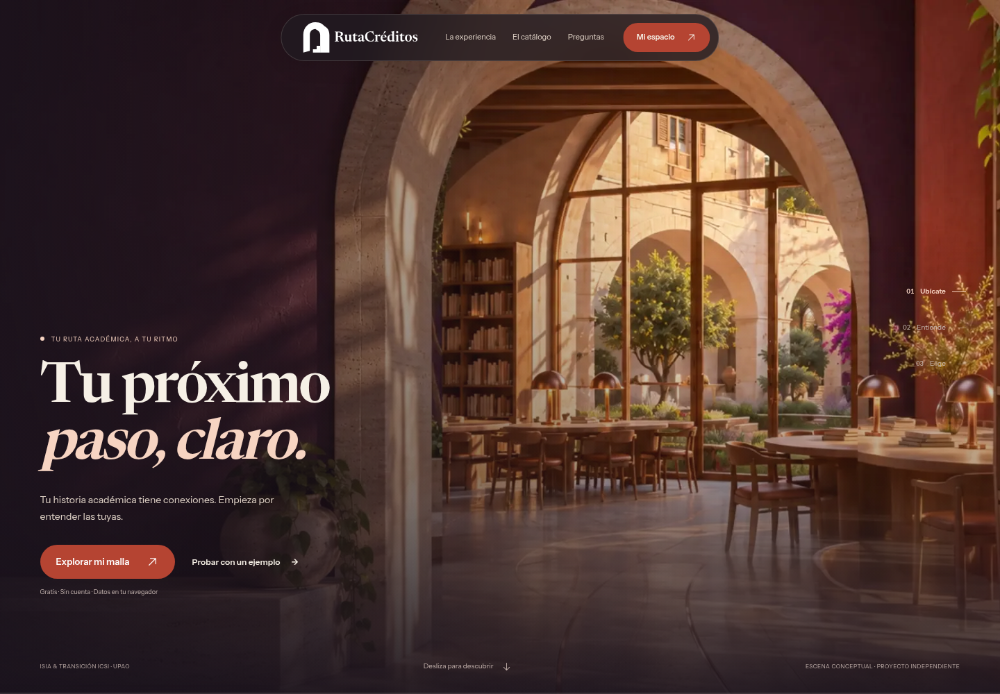
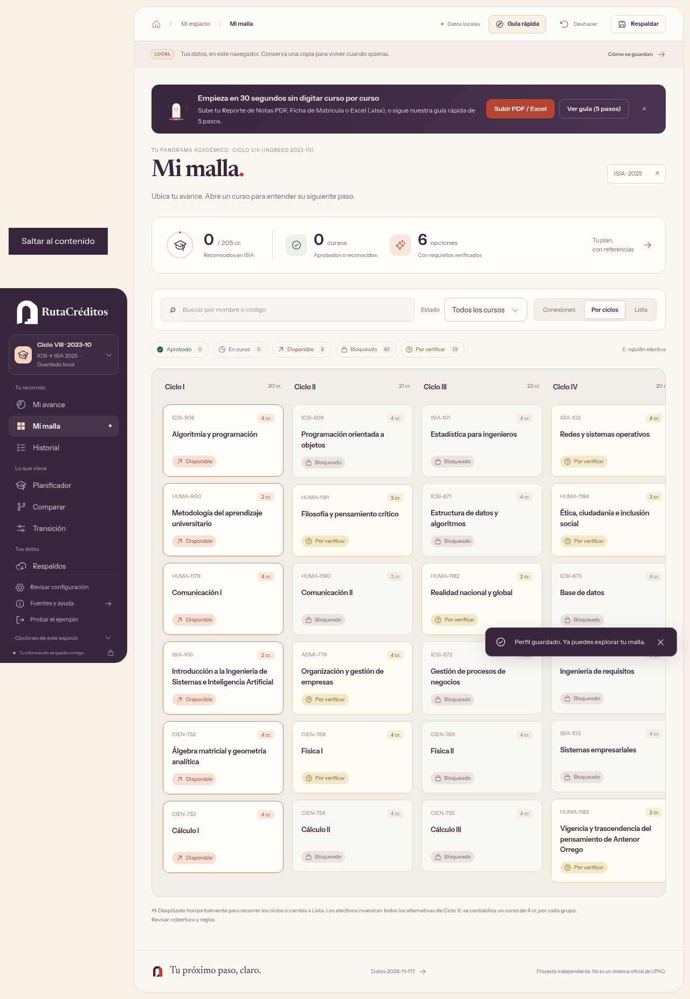
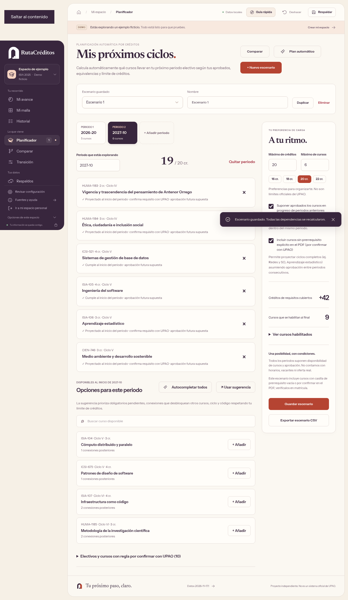
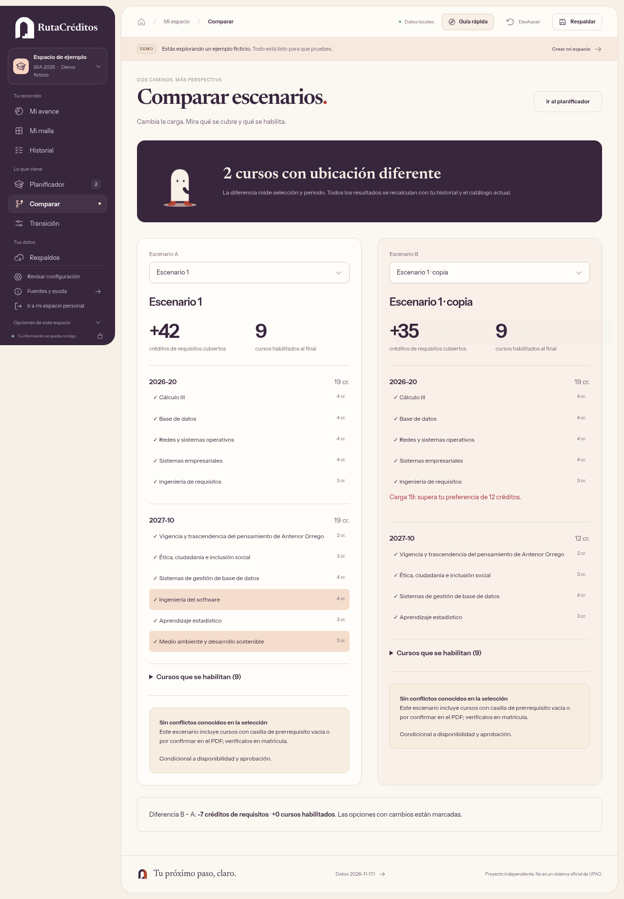
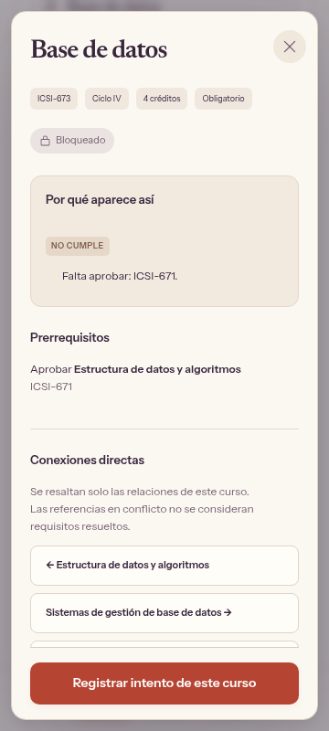
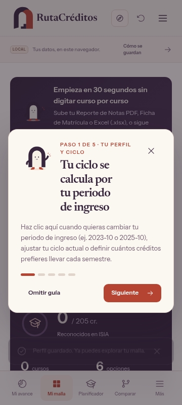
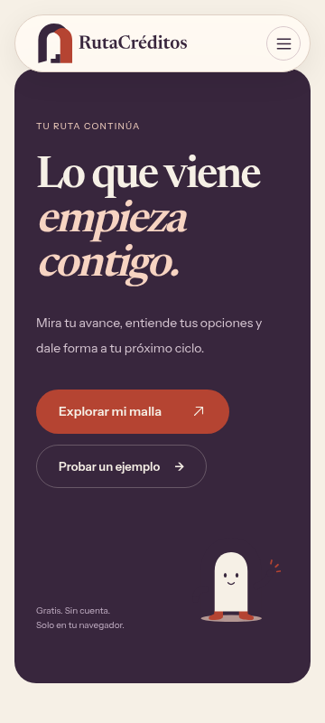

<p align="center">
  <picture>
    <source media="(prefers-color-scheme: dark)" srcset="public/brand/rc-horizontal-mono-blanco.svg">
    
  </picture>
</p>

<p align="center">
  Consulta de avance ISIA, transición desde ICSI y planificación de próximos
  ciclos sin cuenta, con procesamiento íntegro en el navegador.
</p>

<p align="center">
  
  
  
  
</p>



## Qué es

RutaCréditos es una aplicación web pública y sin registro para estudiantes de
Ingeniería de Sistemas e Inteligencia Artificial en UPAO. Consulta el avance del
plan ISIA 2025, revisa las correspondencias desde ICSI 2022 y planifica los
próximos ciclos. Funciona sin API de IA, base de datos ni servicios externos.

El motor evalúa prerrequisitos, créditos y cupos electivos de forma
determinista; conserva las reglas vacías o contradictorias como no verificables
y separa los créditos de origen del avance reconocido en destino.

## Funciones

### Malla y avance

- Portada con un explorador de conexiones interactivo sobre un caso ficticio y
  configuración explícita de cohorte, plan y transición, sin deducir el plan por
  año ni por prefijos de cursos.
- Avance en destino, créditos originales, electivos por cupos e incertidumbres
  separadas; malla por conexiones, ciclos y lista con ficha de requisitos.

### Planificador

- Simulación de varios periodos con carga preferida y heurística determinista.
- Escenarios persistidos y comparador lado a lado con diferencias entre rutas.

### Registro de intentos y respaldo

- Historial con búsqueda, edición por lote con resumen, deshacer y borrado
  confirmado; almacenamiento versionado, recuperación y avisos entre pestañas.
- Respaldo JSON, plantilla e historial CSV, exportación de escenarios, lector
  PDF local con revisión previa y resumen imprimible.

### Transparencia de fuentes

- Transición con evidencia y declaraciones individuales separadas de la tabla,
  conservando inconsistencias sin simular convalidaciones automáticas.

## Capturas



_Muestra el avance por ciclo, filtra por estado y detalla requisitos y
conexiones._



_Simula periodos futuros según límite de créditos, valida requisitos y sugiere
cursos._



_Contrasta dos escenarios y mide la diferencia en créditos cubiertos y cursos
habilitados._

<p align="center">
  
  
  
</p>

## Stack

- Next.js 16.4.6 con App Router, React 19.3.0 y TypeScript 5.9.3
- Tailwind CSS 4.3.5, Base UI 1.9.0, Zod 4.6.7 y pdf.js 6.5.438
- Playwright 1.65.1, Oxlint 1.94.0 y Oxfmt 0.79.0

## Empezar

Requiere **Node 24 LTS**, fijado en `24.22.3` en `.nvmrc` y `.node-version`, y
**pnpm 10.33.2**; el manifiesto fija el ejecutable local de Node y `prepare`
instala Husky en `.git` y copia el worker local de pdf.js sin CDN.

```sh
pnpm install --frozen-lockfile
pnpm dev
```

Abrir `http://localhost:3000`. `/app?mode=demo` carga un perfil ficticio aislado
sin reemplazar `/app`. Scripts: `pnpm typecheck`, `pnpm lint`, `pnpm lint:fix`,
`pnpm format`, `pnpm format:check`, `pnpm catalog:validate`, `pnpm test`,
`pnpm build`, `pnpm start` y `pnpm check`, que encadena hasta el build.

## Pruebas

`pnpm test` valida motor, esquemas Zod, importaciones, recuperación, créditos y
correspondencias. Playwright inicia producción en el puerto **3100** tras un
build previo, usa perfiles y PDF sintéticos en escritorio y 360 px, escribe
capturas en `docs/screenshots/` y admite `PLAYWRIGHT_CHROMIUM_EXECUTABLE`.

```sh
pnpm exec playwright install chromium
pnpm test:e2e
```

## Cobertura académica

El catálogo ISIA viene de `Codificación currículo ISIA-2025.pdf`, inicio
`202510`: **65** opciones de asignatura, **58** obligatorias, **dos cupos
electivos** y **197 + 8 = 205 créditos de requisitos**. ICSI 2022 es origen
parcial, sin malla completa ni certificación de egreso. Se preservan **11
incidencias**, como ISIA-103 y Aprendizaje estadístico, «todo octavo ciclo»,
Tesis II frente a Trabajo de investigación y códigos de origen; reglas vacías o
contradictorias devuelven «no verificable».

La tabla no convalida cursos individuales. Créditos mínimos al inicio de
periodo, en curso no equivale a aprobado y la simulación solo asume aprobados
cursos previos; no hay oferta, horarios ni vacantes. Ver
[auditoría curricular](docs/CURRICULUM_AUDIT.md) y
[límites conocidos](docs/KNOWN_LIMITATIONS.md).

## Privacidad

Los originales de las fuentes y los reportes personales de `docs/private/` están
ignorados por git y excluidos de fixtures, capturas y bundle. No hay analítica,
servidores ni retención de PDFs. `localStorage` es local al origen y navegador,
no sincroniza y puede borrarse; exportar JSON antes de cambiar de equipo y
guardar copias de forma privada.

## Estructura y mantenimiento

Componentes según Josh Comeau en `src/components/Nombre/Nombre.tsx` con
`index.ts` explícito y auxiliares locales; ver
[estructura](docs/COMPONENT_STRUCTURE.md). Motor puro en
`src/helpers/academic.helpers.ts` y esquemas Zod en
`src/helpers/validation.helpers.ts`. Para añadir un plan: fuentes autorizadas e
incidencias, cursos con `none`, `pass`, `and`, `or`, `credits`, `set`, `cycles`
o `unknown`, correspondencias direccionales, opciones de esquema y pruebas. La
app usa `src/data/catalog.json`; se regenera desde `docs/Umbral_Dovi_Final/` con
Python 3 y `pdftotext`/`pdftoppm` usando `pnpm catalog:extract`,
`pnpm catalog:build` y `pnpm catalog:validate`.

Los vídeos de portada se sirven desde `public/hero/` y se regeneran desde
`motion/ruta-world/` con `pnpm motion:prepare`, `pnpm motion:render` y
`pnpm motion:encode`.

## Documentación

- [Estado del proyecto](docs/STATUS.md)
- [Guion de demostración](docs/DEMO_SCRIPT.md)
- [Descripción para postulación](docs/SUBMISSION.md)
- [Investigación de diseño](docs/DESIGN_RESEARCH.md)
- [Plan de implementación](docs/IMPLEMENTATION_PLAN.md)
- [Estructura de componentes](docs/COMPONENT_STRUCTURE.md)
- [Auditoría curricular](docs/CURRICULUM_AUDIT.md)
- [Límites conocidos](docs/KNOWN_LIMITATIONS.md)
- [Capturas en perfiles ficticios](docs/screenshots/)

## Despliegue

No hay despliegue conectado ni URL pública verificada en este repositorio. Para
publicar en Vercel: importar con **Next.js** y **Node.js 24.x**, instalar con
`pnpm install --frozen-lockfile` y compilar con `pnpm build` sin claves ni base
de datos. `NEXT_PUBLIC_SITE_URL` en `.env.example` fija la URL pública opcional;
luego comprobar `/`, `/app?mode=demo`, ficha, escenarios, comparador y JSON. La
postulación exige mantener la aplicación accesible hasta el 21 de noviembre
de 2026.

Proyecto independiente de apoyo estudiantil; no es un sistema oficial de UPAO ni
emite constancias académicas. Las licencias OFL de Newsreader e Instrument Sans
se conservan en `public/brand/`.
